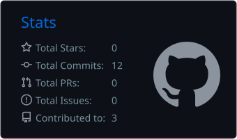
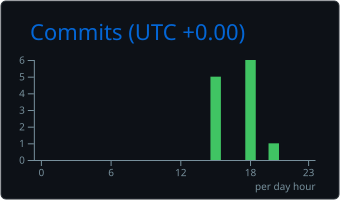

<div align="center">

<picture>
  <source media="(prefers-color-scheme: dark)" srcset="art/header-dark.svg">
  
</picture>


<br/>

<a href="https://github.com/LynkqUK?tab=followers"></a>
<a href="https://github.com/LynkqUK?tab=repositories"></a>


<br/><br/>



</div>



<div align="center">

### `[ 01 ]` &nbsp; WHOAMI

</div>

<table>
<tr>
<td width="62%" valign="middle">

```ini
[identity]
name      = LynkqUK
role      = aspiring software developer
status    = online, building

[focus]
now       = leveling up my dev skills
method    = learn -> experiment -> build -> repeat
rule      = progress over perfection

[mission]
goal      = create meaningful things through code
```

</td>
<td width="38%" align="center" valign="middle">


<br/><br/>


</td>
</tr>
</table>


<div align="center">

### `[ 02 ]` &nbsp; RIGHT NOW

</div>

<table>
<tr>
<td width="33%" valign="top" align="center">

<sub>BUILDING</sub>

**Small projects that ship**

<sub>finished beats perfect</sub>

</td>
<td width="33%" valign="top" align="center">

<sub>LEARNING</sub>

**Python · C++ · the web stack**

<sub>fundamentals first</sub>

</td>
<td width="33%" valign="top" align="center">

<sub>EXPLORING</sub>

**How real software is made**

<sub>reading code, breaking things</sub>

</td>
</tr>
</table>


<div align="center">

### `[ 03 ]` &nbsp; OPERATING PRINCIPLES

</div>

<table>
<tr>
<td width="25%" valign="top" align="center">

**SYSTEMS**

<sub>over motivation</sub>

</td>
<td width="25%" valign="top" align="center">

**CLEAN CODE**

<sub>readable first</sub>

</td>
<td width="25%" valign="top" align="center">

**SMALL LOOPS**

<sub>ship, learn, repeat</sub>

</td>
<td width="25%" valign="top" align="center">

**IN PUBLIC**

<sub>commit daily</sub>

</td>
</tr>
</table>


<div align="center">

### `[ 04 ]` &nbsp; ARSENAL

<br/>


<br/><br/>


</div>


<div align="center">

### `[ 05 ]` &nbsp; GITHUB INTEL

<br/>




<br/><br/>




<br/><br/>


</div>


<div align="center">

### `[ 06 ]` &nbsp; CONTRIBUTION SNAKE

<picture>
  <source media="(prefers-color-scheme: dark)" srcset="https://raw.githubusercontent.com/LynkqUK/LynkqUK/output/github-snake-dark.svg">
  <source media="(prefers-color-scheme: light)" srcset="https://raw.githubusercontent.com/LynkqUK/LynkqUK/output/github-snake.svg">
  
</picture>

</div>


<div align="center">

### `[ 07 ]` &nbsp; ROADMAP

</div>

<table>
<tr>
<td valign="top" width="50%">

```diff
+ set up the profile
+ lock in a daily coding habit
- ship a first full project
- push a project to production
```

</td>
<td valign="top" width="50%">

```diff
- go deeper on C++ and data structures
- make a first open-source contribution
- build something other people use
- keep the streak alive
```

</td>
</tr>
</table>


<div align="center">

### `[ 08 ]` &nbsp; TRANSMISSION

**Got something worth building? Let's talk.**

<br/>

<a href="https://discord.com/users/YOUR_DISCORD_ID"></a>
<a href="https://www.linkedin.com/in/YOUR_LINKEDIN"></a>
<a href="https://x.com/YOUR_X_USERNAME"></a>
<a href="https://www.instagram.com/YOUR_INSTAGRAM"></a>
<a href="https://www.tiktok.com/@YOUR_TIKTOK"></a>
<a href="https://www.youtube.com/@YOUR_YOUTUBE"></a>
<a href="mailto:YOUR_EMAIL@example.com"></a>

<br/><br/>

<sub>OPEN TO LEARNING · BUILDING · COLLABORATING</sub>

</div>


