<div align="center">

<!-- ===================================================================== -->
<!--                              HERO BANNER                              -->
<!-- ===================================================================== -->



<br>


<br><br>

<!-- ===================================================================== -->
<!--                           QUICK NAVIGATION                            -->
<!-- ===================================================================== -->

<a href="#-manifesto"><kbd>&nbsp;&nbsp;01 · ABOUT&nbsp;&nbsp;</kbd></a>
&nbsp;
<a href="#-stack--architecture"><kbd>&nbsp;&nbsp;02 · STACK&nbsp;&nbsp;</kbd></a>
&nbsp;
<a href="#-selected-work"><kbd>&nbsp;&nbsp;03 · WORK&nbsp;&nbsp;</kbd></a>
&nbsp;
<a href="#-telemetry"><kbd>&nbsp;&nbsp;04 · TELEMETRY&nbsp;&nbsp;</kbd></a>
&nbsp;
<a href="#-contact"><kbd>&nbsp;&nbsp;05 · CONTACT&nbsp;&nbsp;</kbd></a>

<br><br>

<!-- ===================================================================== -->
<!--                           ANIMATED TERMINAL                           -->
<!-- ===================================================================== -->



</div>

<br>

<!-- ===================================================================== -->
<!--                             01 · MANIFESTO                            -->
<!-- ===================================================================== -->

<h3 id="-manifesto"><code>// 01 &nbsp;MANIFESTO</code></h3>

<table>
  <tr>
    <td width="54%" valign="top">
      <br>
      <b>I lift heavy things, move wooden pieces, and argue with compilers.</b>
      <br><br>
      Student & developer focused on writing clean <b>C++</b>, <b>Python</b>, and sharp web interfaces.
      Right now the entire objective is simple: turn <i>"I learned it"</i> into <i>"I shipped it."</i>
      <br><br>
      I gravitate toward problems that push back — a bug that refuses to reproduce, a tight chess endgame,
      or an architecture that feels impossible until the last piece locks in.
      <br><br>
      <sub><code>LOCATION // EARTH &nbsp;·&nbsp; MODE // DEEP WORK &nbsp;·&nbsp; STATUS // SHIPPING</code></sub>
      <br><br>
    </td>
    <td width="46%" valign="top">
      <br>
      <code>CURRENT DIRECTIVES</code>
      <br><br>
      <ul>
        <li><b>01.</b> &nbsp;Shipping a complete project from scratch — no tutorial crutches</li>
        <li><b>02.</b> &nbsp;Going deeper into <b>C++</b> memory, STL, and performance</li>
        <li><b>03.</b> &nbsp;Building automation, CLI tooling, and backends in <b>Python</b></li>
        <li><b>04.</b> &nbsp;Reading production codebases to sharpen system design</li>
        <li><b>05.</b> &nbsp;Keeping every UI stark, fast, and human-designed</li>
      </ul>
      <br>
    </td>
  </tr>
</table>

<br>

<div align="center">

<!-- ===================================================================== -->
<!--                    ANIMATED QUESTS & FOCUS EQUALIZER                  -->
<!-- ===================================================================== -->


</div>

<br>

<!-- ===================================================================== -->
<!--                         02 · STACK & ARSENAL                          -->
<!-- ===================================================================== -->

<h3 id="-stack--architecture"><code>// 02 &nbsp;STACK & ARCHITECTURE</code></h3>

<table>
  <tr>
    <td width="25%" valign="top">
      <br>
      <code>CORE LANGUAGES</code>
      <br><br>
      <br>
      <br>
      
      <br><br>
    </td>
    <td width="25%" valign="top">
      <br>
      <code>FRONTEND</code>
      <br><br>
      <br>
      <br>
      <br>
      
      <br><br>
    </td>
    <td width="25%" valign="top">
      <br>
      <code>BACKEND & RUNTIME</code>
      <br><br>
      <br>
      <br>
      
      <br><br>
    </td>
    <td width="25%" valign="top">
      <br>
      <code>ENVIRONMENT</code>
      <br><br>
      <br>
      <br>
      <br>
      
      <br><br>
    </td>
  </tr>
</table>

<br>

<!-- ===================================================================== -->
<!--                           03 · SELECTED WORK                          -->
<!-- ===================================================================== -->

<h3 id="-selected-work"><code>// 03 &nbsp;SELECTED WORK</code></h3>

<table>
  <tr>
    <td width="50%" valign="top">
      <br>
      <code>01 &nbsp;·&nbsp; ● ACTIVE</code>
      <h4><a href="https://github.com/LynkqUK">Flagship Build — First Full Project</a></h4>
      <p>End-to-end software built from zero without following a walkthrough. Designed to break, debug, refactor, and actually ship.</p>
      <kbd>C++</kbd>&nbsp;<kbd>Python</kbd>&nbsp;<kbd>Systems</kbd>
      <br><br>
    </td>
    <td width="50%" valign="top">
      <br>
      <code>02 &nbsp;·&nbsp; ■ SHIPPED</code>
      <h4><a href="https://github.com/LynkqUK">Client Web Architecture</a></h4>
      <p>Fast, responsive landing pages and custom web interfaces engineered for real businesses with clean typography and zero template bloat.</p>
      <kbd>React</kbd>&nbsp;<kbd>Tailwind</kbd>&nbsp;<kbd>Vercel</kbd>
      <br><br>
    </td>
  </tr>
  <tr>
    <td width="50%" valign="top">
      <br>
      <code>03 &nbsp;·&nbsp; ■ SHIPPED</code>
      <h4><a href="https://github.com/LynkqUK">Automation & Custom Bots</a></h4>
      <p>Utility scripts, Discord automation, and performance tooling built to eliminate repetitive manual workflows.</p>
      <kbd>Python</kbd>&nbsp;<kbd>Node.js</kbd>&nbsp;<kbd>APIs</kbd>
      <br><br>
    </td>
    <td width="50%" valign="top">
      <br>
      <code>04 &nbsp;·&nbsp; ○ IN PROGRESS</code>
      <h4><a href="https://github.com/LynkqUK">LynkqUK Profile Engine</a></h4>
      <p>Zero-dependency Python SVG generator powering this entire repository — animated monochrome graphics compiled automatically.</p>
      <kbd>Python</kbd>&nbsp;<kbd>SVG</kbd>&nbsp;<kbd>Actions</kbd>
      <br><br>
    </td>
  </tr>
</table>

<br>

<div align="center">

<!-- ===================================================================== -->
<!--                       ANIMATED CHESS & MINDSET                        -->
<!-- ===================================================================== -->


</div>

<br>

<!-- ===================================================================== -->
<!--                        INTERACTIVE DOSSIERS                           -->
<!-- ===================================================================== -->

<h3><code>// 04 &nbsp;FIELD NOTES</code></h3>

<details>
  <summary><b>▸ &nbsp;Engineering Principles</b> — how I write and review code</summary>
  <br>
  <table>
    <tr>
      <td width="30%"><code>READABILITY</code></td>
      <td>Clever one-liners age badly. Write code that future-you can debug half-asleep in thirty seconds.</td>
    </tr>
    <tr>
      <td width="30%"><code>FORMATTING</code></td>
      <td>Tabs vs. spaces is a tax on your time. Run the formatter and get back to real problems.</td>
    </tr>
    <tr>
      <td width="30%"><code>EXECUTION</code></td>
      <td>Motivation shows up late and discipline runs out. Build systems that run automatically every day.</td>
    </tr>
    <tr>
      <td width="30%"><code>TOOLING</code></td>
      <td>The best programming language is whichever one solves the current problem cleanly. Stay sharp across paradigms.</td>
    </tr>
  </table>
  <br>
</details>

<details>
  <summary><b>▸ &nbsp;Off-Screen</b> — training, chess, math & games</summary>
  <br>
  <table>
    <tr>
      <td width="30%"><code>TRAINING</code></td>
      <td>Consistent heavy lifting on an Upper / Lower split. Progressive overload applies to code the exact same way.</td>
    </tr>
    <tr>
      <td width="30%"><code>CHESS</code></td>
      <td>Endgame calculation, sharp gambits, and tactical motifs. Quiet moves beat flashy blunders.</td>
    </tr>
    <tr>
      <td width="30%"><code>GAMES</code></td>
      <td>Chess · Rocket League · Minecraft · Competitive FPS when the IDE closes.</td>
    </tr>
    <tr>
      <td width="30%"><code>SOUND</code></td>
      <td>Headphones on, world muted. Late-night atmospheric tracks while building.</td>
    </tr>
  </table>
  <br>
</details>

<details>
  <summary><b>▸ &nbsp;Changelog</b> — profile & dev log</summary>
  <br>

```text
v3.0  [2026]  Monochrome noir overhaul · custom animated SVG engine · zero clutter
v2.0  [2026]  Switched focus to C++ & Python fundamentals · full-stack web builds
v1.0  [2025]  First shipped sites, automation bots, and GitHub profile launch
