<!-- Everything below is generated. To change the words, edit .github/banners.json and commit: the banners rebuild themselves. -->

<picture>
  <source media="(prefers-color-scheme: dark)" srcset="art/header-dark.svg">
  
</picture>

  

  

  

  

  

  

  

<!--
More links, when you are ready: fill in your handles and remove the comment markers around this block.

-->
