

<picture>
  <source media="(prefers-color-scheme: dark)" srcset="art/header-dark.svg">
  
</picture>

  


  

  

 


  

 

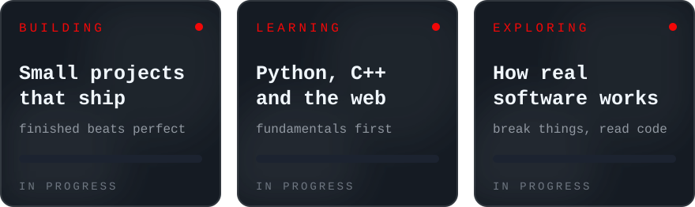

  

 


  


 


  

  

  

  

  


 

<picture>
  <source media="(prefers-color-scheme: dark)" srcset="https://raw.githubusercontent.com/LynkqUK/LynkqUK/output/github-snake-dark.svg">
  <source media="(prefers-color-scheme: light)" srcset="https://raw.githubusercontent.com/LynkqUK/LynkqUK/output/github-snake.svg">
  
</picture>

  


 


  


  

<a href="https://www.instagram.com/YOUR_INSTAGRAM">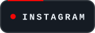</a>
<a href="https://www.tiktok.com/@YOUR_TIKTOK">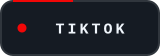</a>

 


