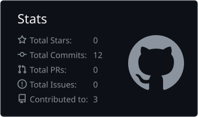
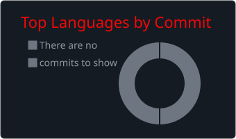

<picture>
  <source media="(prefers-color-scheme: dark)" srcset="art/header-dark.svg">
  
</picture>

 

### Islam · LynkqUK

Student, learning to build software. Mostly Python and C++ for now, with some web on the side. I like small projects that actually get finished.

 

**What I'm up to**

- Learning C++ properly and getting more comfortable in Python
- Working toward a first full project I can put in front of other people
- Reading other people's code to see how real software gets put together

 

**Stack**

      

 

**Find me**

<!--
Add more links when you are ready: fill in your handles and remove the comment markers around this block.

-->

<!--
GitHub stats: these fill in once you have some commits. Uncomment then.

 
-->
