 

<picture>
  <source media="(prefers-color-scheme: dark)" srcset="art/header-dark.svg">
  
</picture>

 

 

**ASPIRING DEVELOPER · BUILDER · PROBLEM SOLVER**

 

  

INDEPENDENT THINKING. CONTINUOUS IMPROVEMENT.

---

### 01 — THE DEVELOPER

**I don't just want to understand technology. I want to build with it.**

<table>
<tr>
<td width="65%" valign="middle">

I'm **LynkqUK**, an aspiring software developer interested in programming, software engineering and digital products.

I enjoy exploring how technology works, experimenting with different languages and turning ideas into real projects.

 

- **INTERESTS** — Software, programming & technology
- **CURRENT FOCUS** — Improving my development skills
- **MINDSET** — Learn, experiment, build, repeat
- **GOAL** — Create meaningful things through code

 

*The goal is progress, not perfection.*

</td>
<td width="35%" align="center" valign="middle">

  

**LYNKQUK**

DEVELOPER IN PROGRESS

</td>
</tr>
</table>

---

### 02 — ARSENAL

LANGUAGES · TECHNOLOGIES · TOOLS

  

**PROGRAMMING LANGUAGES**

  

**DEVELOPMENT ENVIRONMENT**

---

### 03 — GITHUB INTELLIGENCE

THE WORK SPEAKS FOR ITSELF.

  

  

  

---

### 04 — CONTRIBUTION MATRIX

EVERY COMMIT LEAVES A MARK.

  

<picture>
  <source media="(prefers-color-scheme: dark)" srcset="https://raw.githubusercontent.com/LynkqUK/LynkqUK/output/github-contribution-grid-snake-dark.svg">
  <source media="(prefers-color-scheme: light)" srcset="https://raw.githubusercontent.com/LynkqUK/LynkqUK/output/github-contribution-grid-snake.svg">
  
</picture>

<!--
==========================================================
GITHUB CONTRIBUTION SNAKE AUTOMATION
==========================================================

Create a separate file:

.github/workflows/snake.yml

Paste this workflow into it:

name: Generate Contribution Snake

on:
  schedule:
    - cron: "0 0 * * *"
  workflow_dispatch:
  push:
    branches:
      - main

permissions:
  contents: write

jobs:
  generate:
    runs-on: ubuntu-latest

    steps:
      - name: Generate Snake
        uses: Platane/snk@v3
        with:
          github_user_name: LynkqUK
          outputs: |
            dist/github-contribution-grid-snake.svg
            dist/github-contribution-grid-snake-dark.svg?palette=github-dark

      - name: Deploy to Output Branch
        uses: crazy-max/ghaction-github-pages@v4
        with:
          target_branch: output
          build_dir: dist
        env:
          GITHUB_TOKEN: ${{ secrets.GITHUB_TOKEN }}

IMPORTANT:
1. Enable GitHub Actions.
2. Run the workflow manually.
3. Wait for the output branch to be created.
4. The snake will update automatically every day.

==========================================================
-->

---

### 05 — TRANSMISSION

**Have something worth building? Let's connect.**

  

  

OPEN TO LEARNING · BUILDING · COLLABORATING

---

 

**LYNKQUK**

BUILT WITH INTENTION. DRIVEN BY CURIOSITY.

  

